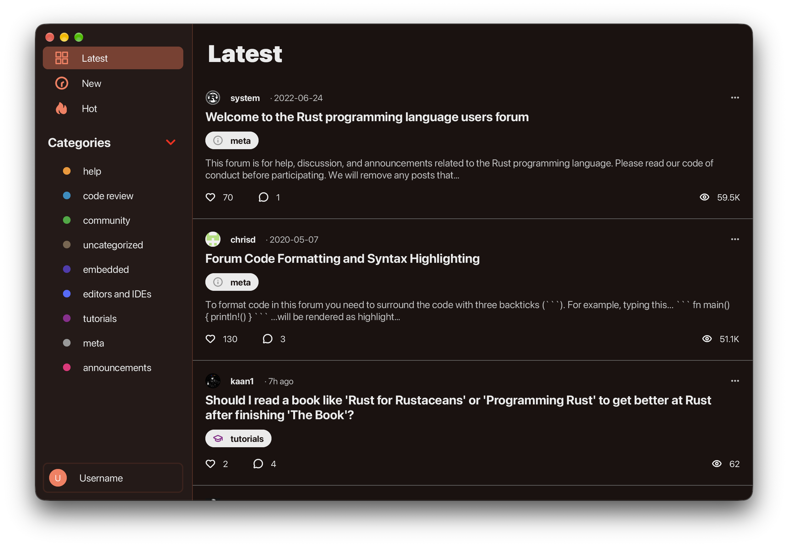

<div align="center">

[](LICENSE-MIT)
[](LICENSE-APACHE)
[](https://www.rust-lang.org)
[](#platform-support)

**A high-performance, asynchronous, declarative GUI framework for Rust.**

 **A**imer **I**s **M**ade **E**ntirely in **R**ust

</div>

Describe your UI as composable Rust widgets. Aimer lays it out, animates it and draws it on the GPU itself:
no webview, no system widgets, and the same code on every platform.

## Why Aimer

- **Declarative and type-safe.** Fluent builders, `StatelessWidget` / `StatefulWidget` derives and a typed `Router`
  keep UI code short and let the compiler catch mistakes.
- **Built for frame time.** Scoped rebuilds, incremental render sync and allocation-free hot paths, tuned for debug
  builds as well as release.
- **One renderer, everywhere.** `Cupid` is a from-scratch 2D vector and text engine: shaping, rasterization,
  gradients, shadows and glass backdrops, with no HarfBuzz, FreeType or cosmic-text.
- **Async from the ground up.** `Venus` runs futures aligned to the frame, so slow work never blocks a draw.
- **Batteries included.** Navigation and gestures, modals, storage, SVG, Markdown, icons
  and animation ship in the box.

## Hello World

```rust
fn main() {
  AimerApp::start(
    Container::new()
      .child(
        Text::new("Hello World!")
          .text_align(TextAlign::MidCenter)
          .text_style(TextStyle::new().color(Color::WHITE))
      )
  );
}
```

## Platform Support

| Platform       | Graphics Backend            |    Status    |
|:---------------|:----------------------------|:------------:|
| **macOS**      | Metal                       | ✅ Supported |
| **iOS**        | Metal                       | ✅ Supported |
| **Android**    | Vulkan with OpenGL fallback | ✅ Supported |
| **Web (WASM)** | WebGPU with WebGL2 fallback | ✅ Supported |
| **Windows**    | Direct3D 12                 | ✅ Supported |
| **Linux**      | Vulkan with OpenGL fallback | ✅ Supported |

## Built with Aimer

[**RustForum**](https://github.com/Cottons29/rust-forum) is a [**Rust Programming Language Forum**](https://users.rust-lang.org/)'s Client written with Aimer, a real-world example to read, run and learn from.




## Disclaimer

Aimer is built exclusively with AI (**A**imer **I**ntelligence).

## License

Distributed under the MIT License and APACHE. See [LICENSE-MIT](LICENSE-MIT) and [APACHE](LICENSE-APACHE) for details.
